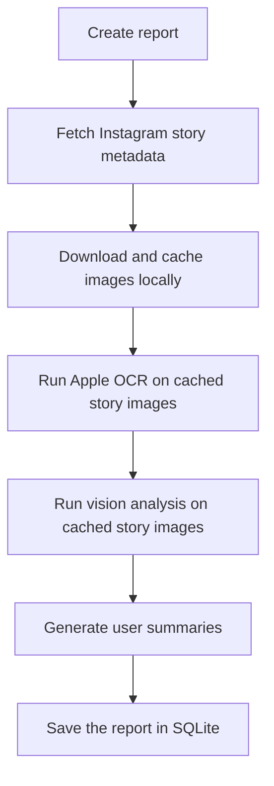

# Slopstagram

[](https://sonarcloud.io/summary/overall?id=adrienZ_slopstagram)

## Prerequisites

Install [Node.js](https://nodejs.org/) 24 or newer. The application runs on Node.js,
but its standalone [bunqueue](https://bunqueue.dev/) server still requires
[Bun](https://bun.sh/) 1.3.14 or newer.

Install [Ollama](https://ollama.com/).

Install the Chromium build used by Playwright:

```bash
npx playwright install chromium
```

Install the vision model on every platform:

```bash
ollama pull minicpm-v4.6:latest
```

Then install the user-summary model for your platform.

On an Apple Silicon Mac:

```bash
ollama pull qwen3.5:0.8b-mlx
```

On Windows, Linux, or an Intel Mac:

```bash
ollama pull qwen3.5:0.8b
```

The application selects the matching model automatically. The MLX variant is optimized for
Apple Silicon and is not available on Windows; the standard variant is the portable fallback.

## Setup

```bash
npm install
```

Authenticate in a persistent Playwright session:

```bash
npm run auth
```

Complete the Instagram login in the opened browser, Then close the browser.

## Usage

Create report:

```bash
npm run create:report
```

### Report pipeline



View reports:

```bash
npm run start
```

Open <http://localhost:5173/>.

### Recover sticker metadata from cache

After starting the server once to initialize the current database schema, run:

```bash
npm run enrich:sticker-metadata
```

This reads raw location and music observations from `data/cache/stories/*.json`
and fills missing metadata for existing stories. It never fetches Instagram,
runs migrations, or changes story media, owners, labels, or report snapshots.
`SLOPSTAGRAM_DATABASE_PATH` can select another already initialized database.

The summary counts usable observations processed (`enriched`), incomplete
observations processed (`partial`), absent stories or empty inputs (`skipped`),
observations without a certain occurrence link or rejected conflicting evidence
(`uncertain`), malformed files/sources (`invalid`), and rolled-back stories
(`failed`). These counters overlap; a rerun can count previously processed data.
Invalid or failed inputs give the command a nonzero exit status. Raw responses
and error payloads are never printed.

Reruns are safe: each story commits atomically, shared provider IDs reuse metadata,
and deterministic cache evidence keys preserve distinct identical observations.
Labels and array positions never establish historical occurrence identity. When
existing observations cannot be distinguished safely, they are preserved and the
cached input is reported as uncertain rather than creating duplicate evidence.

## Development

Cached media, the SQLite databases, and the Playwright profile are stored in `./data`.
Database migrations are applied automatically when the Nitro server starts and before report
creation. After changing an entity schema, generate a migration with:

```bash
npm run db:generate
```

### Matt Pocock's engineering skills

This repository is configured for Matt Pocock's engineering skills. The
[agent instructions](./AGENTS.md#agent-skills) point to the repository conventions:

- [Issue tracker](./docs/agents/issue-tracker.md): GitHub Issues in `adrienZ/slopstagram`.
- [Triage labels](./docs/agents/triage-labels.md): `needs-triage`, `needs-info`,
  `ready-for-agent`, `ready-for-human`, and `wontfix`.
- [Domain docs](./docs/agents/domain.md): a root `GLOSSARY.md` and `docs/adr/`, created
  as terminology and decisions are resolved.

Edit `docs/agents/*.md` directly to update these conventions. Re-running
`/setup-matt-pocock-skills` is only needed to switch issue trackers or restart setup.

## Runtime rationale

The Nitro application and scripts run on Node.js. Bun is retained only for the
standalone bunqueue server. See [RATIONALE.md](./RATIONALE.md) for details.
