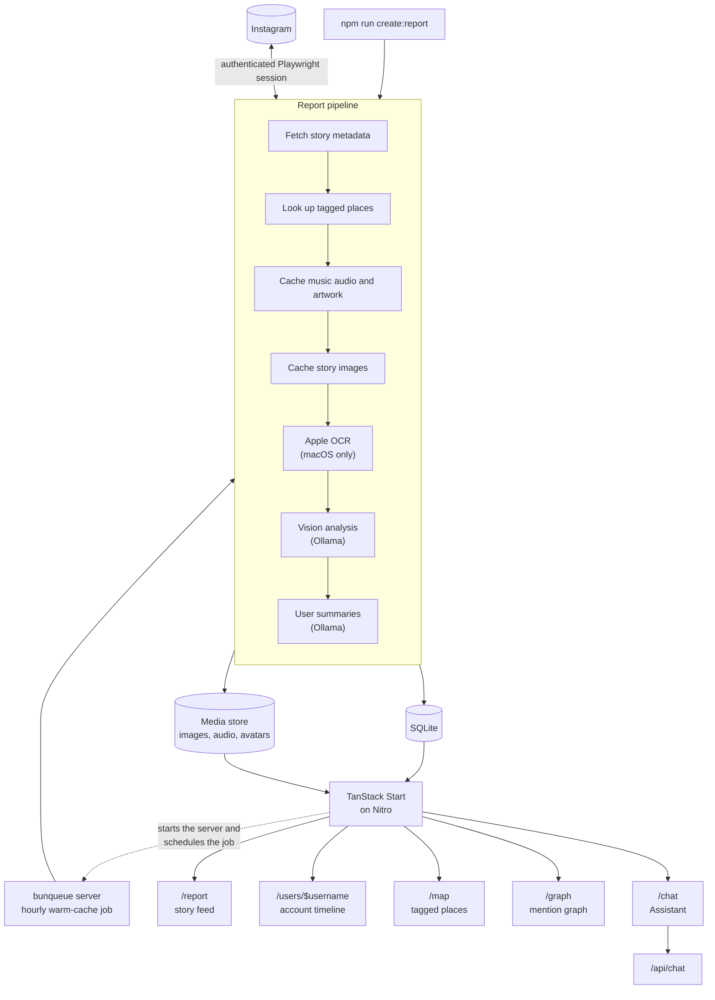

# Slopstagram

**Your Instagram story feed, archived and analysed on your own machine.**

Instagram stories vanish after 24 hours. Slopstagram collects the stories of the accounts you
follow into a rolling feed you can browse by day. It caches their images and music, reads them
with local vision models, and lets you explore the places and people they tag, or ask an
Assistant about them. No cloud AI: OCR runs on Apple Vision, every model runs in Ollama, and
everything lives in a local SQLite database.

[](https://github.com/adrienZ/slopstagram/actions/workflows/check.yml)
[](https://sonarcloud.io/summary/overall?id=adrienZ_slopstagram)


## Features

- 📅 **Story feed**: every story, grouped by account, browsable day by day.
- 🎵 **Stickers decoded**: mentions, hashtags, links, places and playable music.
- 👤 **Account timelines**: all the stories an account has posted.
- 🗺️ **Places map**: every tagged place on a map, with its stories.
- 🕸️ **Mention graph**: who mentions whom, filterable by account.
- 👁️ **Local vision**: OCR, image analysis and a daily summary per account.
- 💬 **Chat Assistant**: ask about your feed, answered by a local model with tools.
- ⏰ **Hourly refresh**: new stories fetched while the app runs.

The interface is in French.


| Places map                                                                                                 | Mention graph                                                                                         |
| ---------------------------------------------------------------------------------------------------------- | ----------------------------------------------------------------------------------------------------- |
|  |  |


## How it works

Each fetch run, started by `npm run create:report` or by the hourly job, runs the report
pipeline. The TanStack Start server renders every page from SQLite and the local media store.
On startup, its Nitro plugin launches the bunqueue server and schedules the hourly job that
runs the report pipeline again.



## Privacy and disclaimer

Slopstagram is a personal project, not affiliated with Instagram or Meta. It reads the
stories your own logged-in account can see, through a browser session you open yourself.
Automated access may break Instagram's terms of use: use it at your own risk, on your own
account.

Everything it collects stays in `./data`: the SQLite database, cached media and the browser
profile. Story images and text go only to Apple Vision and Ollama, both running on your
machine. Tests and evals use synthetic data only, and a test fails if the name of an account
you follow appears in the source.

## Prerequisites

Install [Node.js](https://nodejs.org/) 24 or newer. The application runs on Node.js,
but its standalone [bunqueue](https://bunqueue.dev/) server still requires
[Bun](https://bun.sh/) 1.4.4 or newer.

Install [Ollama](https://ollama.com/).

Install the Chromium build used by Playwright:

```bash
npx playwright install chromium
```

Install the vision model on every platform:

```bash
ollama pull minicpm-v4.6:latest
```

Then install the user-summary model for your platform.

On an Apple Silicon Mac:

```bash
ollama pull qwen3.5:0.8b-mlx
```

On Windows, Linux, or an Intel Mac:

```bash
ollama pull qwen3.5:0.8b
```

The application selects the matching model automatically. The MLX variant is optimized for
Apple Silicon and is not available on Windows; the standard variant is the portable fallback.

## Setup

```bash
npm install
```

Authenticate in a persistent Playwright session:

```bash
npm run auth
```

Complete the Instagram login in the opened browser, then close the browser.

## Usage

Create report:

```bash
npm run create:report
```

View reports:

```bash
npm run dev
```

Open <http://localhost:5173/>. While the server runs, it fetches new stories every hour.

## Development

Cached media, the SQLite databases, and the Playwright profile are stored in `./data`.
Database migrations are applied automatically when the Nitro server starts; scripts expect
an initialized database. After changing an entity schema, generate a migration with:

```bash
npm run db:generate
```

Validate a change (lint, typecheck, deadcode, tests):

```bash
npm run check
```

Run the assistant evals:

```bash
npm run eval
```

### Matt Pocock's engineering skills

This repository is configured for Matt Pocock's engineering skills. The
[agent instructions](./AGENTS.md#agent-skills) point to the repository conventions:

- [Issue tracker](./docs/agents/issue-tracker.md): GitHub Issues in `adrienZ/slopstagram`.
- [Triage labels](./docs/agents/triage-labels.md): `needs-triage`, `needs-info`,
  `ready-for-agent`, `ready-for-human`, and `wontfix`.
- [Domain docs](./docs/agents/domain.md): a root `GLOSSARY.md` and `docs/adr/`, created
  as terminology and decisions are resolved.

Edit `docs/agents/*.md` directly to update these conventions. Re-running
`/setup-matt-pocock-skills` is only needed to switch issue trackers or restart setup.

## Runtime rationale

The Nitro application and scripts run on Node.js. Bun is retained only for the
standalone bunqueue server. See [RATIONALE.md](./RATIONALE.md) for details.
